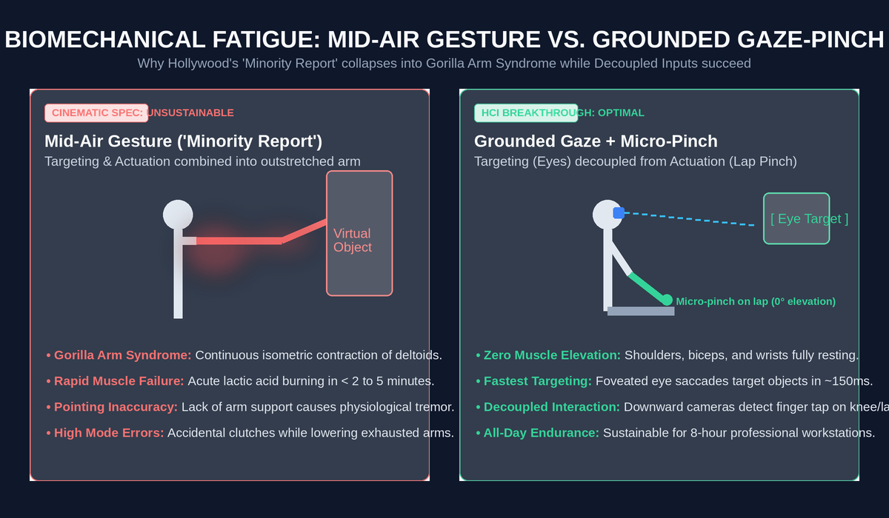
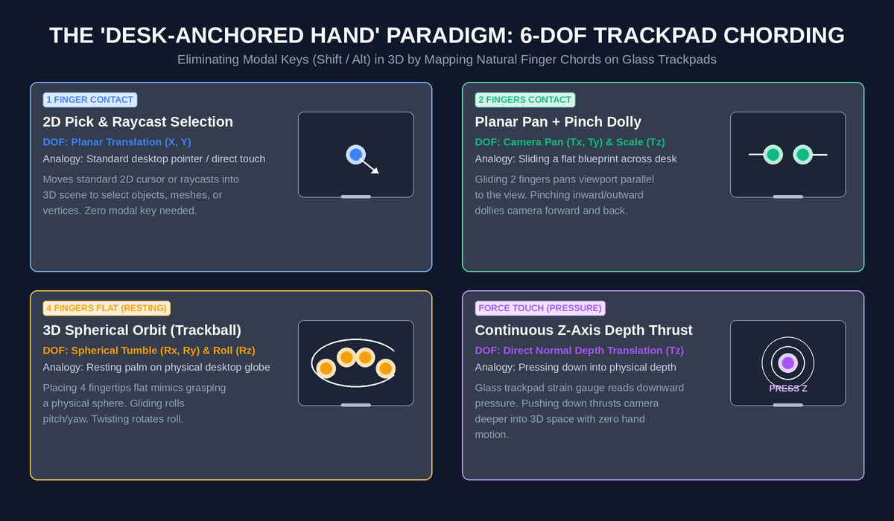
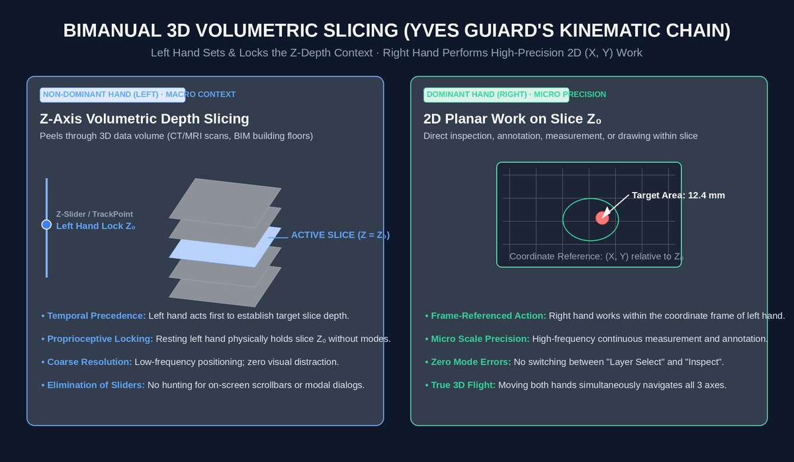

# Daily Journal — 2026-10-17: Needfinding for 3D Spatial Interfaces & The Death of Mid-Air Waving

## 1. Raw Reflection & Needfinding Inquiry
Reflecting on cinematic depictions of spatial computing (Tom Cruise in *Minority Report*, Robert Downey Jr. as Tony Stark in *Iron Man* interacting with JARVIS and 3D floating holograms):
- The general public does not have an everyday need to manipulate floating 3D objects in mid-air. Everyday computing is largely 2D symbolic information (text, code, spreadsheets, video).
- **Needfinding question:** Where does 3D spatial manipulation genuinely provide irreplaceable value over 2D screens?
  1. **Sterile Surgical Theaters (Surgeons):** Inspecting volumetric MRI/CT scans (tumors, vascular structures, infections). Physical contact with mice/touchpads violates the sterile field. But surgeons don't need complex mid-air hand dancing—they need basic affine transforms (**Rotate, Pan, Scale**) that can be driven by sterile non-contact sensors (gaze, foot pedals, voice, micro-gestures).
  2. **Architectural BIM (Building Information Modeling):** Modern structures involve overlapping mechanical, electrical, plumbing (MEP), and structural systems. Mentally projecting multi-layer 2D blueprints creates high cognitive load and causes spatial clashes. 3D spatial models reduce this mental simulation burden, but 8-hour workdays demand forearm support on a desk (e.g., 3Dconnexion SpaceMouse), not standing mid-air waving.
  3. **Spatial Headsets (HoloLens, Apple Vision Pro) & Gorilla Arm:**
     - Headsets remain niche/gaming/expensive because high weight, visual isolation, and ergonomic friction limit prolonged productivity.
     - **Apple Vision Pro's Key Interaction Breakthrough:** Decoupling *Targeting* (eye gaze) from *Actuation* (micro-pinch on the lap). However, if an interface tempts the user into reaching forward to grab floating windows, fatigue sets in within 10 minutes.
     - **Spatial Telepresence:** Moving beyond flat Zoom boxes to spatial personas with true parallax and mutual gaze vectors.

---

## 2. HCI First-Principles Synthesis

```
┌─────────────────────────────────────────────────────────────────────────────┐
│                    SPATIAL COMPUTING INPUT PARADIGMS                        │
├───────────────────┬────────────────────────────┬────────────────────────────┤
│ Dimension         │ Hollywood (Mid-Air Waving) │ Ergonomic Spatial (AVP/Desk│
├───────────────────┼────────────────────────────┼────────────────────────────┤
│ Targeting Sensor  │ Outstretched Hands (Kinect)│ Foveated Eye Gaze Tracking │
│ Actuation Sensor  │ Mid-Air Grabbing / Swiping │ Micro-Pinch on Lap / Desk  │
│ Musculoskeletal   │ Acute Deltoid / Trapezius  │ Zero Arm Elevation;        │
│ Endurance         │ Strain (< 5–10 minutes)    │ Relaxed Forearm Support    │
│ Primary Barrier   │ "Gorilla Arm Syndrome"     │ Sub-millimeter Eye Jitter  │
└───────────────────┴────────────────────────────┴────────────────────────────┘
```

### A. The Sterility Paradox in Medicine
- In operating rooms, the barrier to computing is **microbial transmission**. Every keyboard is a fomite.
- HCI researchers spent years attempting mid-air Leap Motion / Kinect gesture controls for surgeons.
- **Why they failed:** Mid-air gesture tracking suffers from false positives, unintended clutch triggers, and physical fatigue. The ultimate solution respects the surgeon's primary motor channel: hands remain on surgical instruments, while view inspection (Rotate/Pan/Zoom) is offloaded to **foot pedals, eye dwell, or voice**.

### B. Hollywood's Fatal Flaw: Coupling Targeting to Actuation
- In Douglas Engelbart's 1968 *Mother of All Demos*, the mouse succeeded because it rested on a flat surface with forearm support.
- Hollywood (*Minority Report*) conflated **visual theater** with **biomechanical efficiency**. Holding hands up at eye level requires constant isometric contraction of the shoulder girdle.
- Apple Vision Pro recognized this: the cameras look downward at the lap. You look with your eyes (fastest motor mechanism in the human body, ~100–300ms saccades) and pinch your fingers while your hands rest on your thighs.


*> Figure 1: Mid-Air Gesture vs. Grounded Gaze-Pinch — Hollywood's coupled pointing causes acute deltoid failure (Gorilla Arm in < 5 mins), while decoupling targeting to foveated gaze and clicking to lap micro-pinch preserves resting muscle tone.*


---

## 3. Post & Project Connections
- Directly enriches the Week 1 / Week 2 transition and post idea: [[post-ideas#💡 Post Ideas|Why Tom Cruise's Interface Would Break Your Shoulders: Engelbart's Mouse, Gorilla Arm Syndrome, and the Hunt for 3D Input]].
- Connects to Stanford CS147 Assignment 1: **Needfinding (Finding real user breakdowns rather than inventing sci-fi solutions)**.

---

## 4. The "Desk-Anchored Hand" Paradigm: Multi-Finger Trackpad 6-DOF Mapping

### A. The Core Insight: Zero-Elevation 3D Manipulation
- Instead of waving hands in the air or wearing heavy headsets, keep the **entire hand and forearm anchored on the desk** (e.g., MacBook glass trackpad).
- Human hands naturally rest on the laptop palm rest. This provides:
  1. **Zero muscle fatigue:** Zero deltoid/trapezius contraction; sustainable for 10-hour workdays.
  2. **Tremor suppression:** Grounding the wrist against the laptop aluminum suppresses micro-tremors, yielding sub-millimeter precision.

### B. Why Traditional 2-Finger 3D Interaction Feels Clunky
- Standard CAD/3D software (Blender, Maya, Fusion 360) maps 3D camera controls to 2D inputs using **keyboard clutch modifiers** (`Shift + MiddleClick`, `Alt + LeftClick`).
- On a trackpad, 2 fingers are naturally interpreted as a planar 2D scroll or pinch-to-zoom. Forcing 2 fingers to also handle 3D orbital tumbling feels awkward because 2 contact points form a line segment—insufficient for intuitive 3D rotational anchoring.

### C. The 4-Finger "Virtual Trackball" Model
By assigning specific chorded finger counts to distinct kinematic channels, we eliminate modal keys:

```
┌─────────────────────────────────────────────────────────────────────────────┐
│             DESK-ANCHORED 6-DOF MULTI-TOUCH CHORDING MATRIX                 │
├───────────────┬───────────────────────────┬─────────────────────────────────┤
│ Contact Posture│ Kinematic Degrees of Freedom│ Mental Model / Real-World Analogy│
├───────────────┼───────────────────────────┼─────────────────────────────────┤
│ 1 Finger      │ Pointer / Selection (X, Y)│ Direct 2D cursor / Raycast pick │
│ 2 Fingers     │ Planar Pan + Pinch Dolly  │ Grabbing a flat paper sheet     │
│ 3–4 Fingers   │ 3D Spherical Orbit (Rx,Ry)│ Resting palm on a physical globe│
│ Finger Twist  │ In-Plane Roll (Rz)        │ Twisting a physical jar lid     │
│ Force Touch   │ Direct Z-Axis Depth Push  │ Pushing down into spatial depth │
└───────────────┴───────────────────────────┴─────────────────────────────────┘
```

1. **3–4 Fingers = Virtual Trackball (Orbit):** Placing 3 or 4 fingertips flat on the glass pad mimics resting your palm on a floating billiard ball. Sliding the fingertip cluster rolls the 3D model in pitch and yaw ($R_x, R_y$).
2. **Twist = Roll ($R_z$):** Rotating the fingertips relative to the palm angle twists the viewport.
3. **Force Touch = Continuous $Z$ Thrust:** Applying downward pressure on the glass translates the camera forward into the scene without needing to lift a finger or drag endlessly across the pad.


*> Figure 2: The "Desk-Anchored Hand" Multi-Touch Chording Matrix — Mapping 6-DOF spatial control to natural finger counts (1-finger pick, 2-finger pan, 4-finger orbit, Force Touch Z-thrust) eliminates modal key switches while grounding the wrist.*


---

## 5. Bimanual Asymmetric 3D Interaction: Guiard's Kinematic Chain in Action

### A. The Two-Handed Breakthrough
- When operating in 3D, assigning all 3 dimensions plus rotation to a single hand causes **cognitive and kinematic congestion**.
- **The Core User Insight:** Use the **non-dominant hand (Left Hand)** to control the extra spatial dimension (**Z-axis depth slice**), while the **dominant hand (Right Hand)** performs fine operations on the 2D $(X, Y)$ plane of that specific slice!
- **State Preservation:** When the Left Hand stops at a specific depth $Z = Z_0$, it holds that exact cross-sectional slice in place. The Right Hand can immediately inspect, measure, draw, or annotate in $(X, Y)$.

### B. HCI Grounding: Yves Guiard's Kinematic Chain Model (1987)
In human motor control, the two hands do not act as symmetrical duplicates. They form a serial kinematic chain:
1. **Right-to-Left Spatial Reference:** The non-dominant hand defines the macro spatial reference frame (holding/moving the Z-slice). The dominant hand moves within that reference frame (navigating X, Y).
2. **Asymmetric Temporal Precedence:** The non-dominant hand initiates action first (finding the target depth layer); the dominant hand acts subsequently (detailed inspection/drawing).
3. **Coarse-to-Fine Scale Division:** Left hand provides coarse positional anchoring (Z-depth plane); Right hand provides micro-precision tracking (pixel-level manipulation).

```
┌─────────────────────────────────────────────────────────────────────────────┐
│                 BIMANUAL 3D VOLUMETRIC SLICING ARCHITECTURE                 │
├──────────────────────────────┬──────────────────────────────────────────────┤
│ Non-Dominant Hand (Left)     │ Dominant Hand (Right)                        │
│ Role: Macro Context / Z-Axis │ Role: Micro Precision / Planar (X, Y) Canvas │
├──────────────────────────────┼──────────────────────────────────────────────┤
│ • Controls Z-depth slicing   │ • Standard 1/2-finger cursor & gestures      │
│ • Holding = locks Z=Z₀ slice │ • Operates on the 2D cross-section at Z₀     │
│ • Moving = continuous 3D peel│ • Both moving = fluid 3D spatial flight      │
└──────────────────────────────┴──────────────────────────────────────────────┘
```


*> Figure 3: Guiard's Kinematic Chain in Volumetric Slicing — The non-dominant (left) hand scrubs and proprioceptively locks the Z-depth slice Z₀, while the dominant (right) hand performs high-precision 2D (X, Y) analysis within that plane.*


