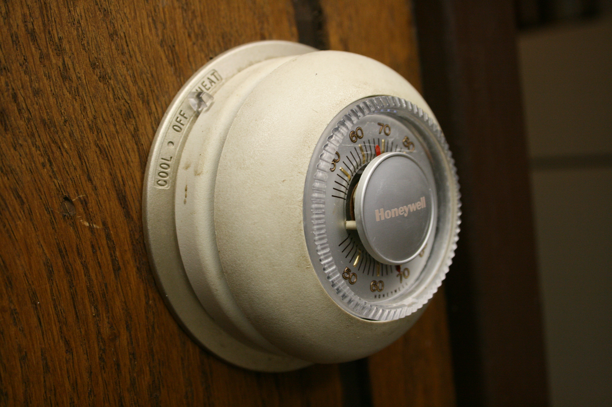

# Conceptual Models & The System Image

*Designers and users never meet; the product itself is the only message between them.*

> [!abstract] At a glance
> **What:** Design model, user's model and system image (Norman's triad).
> **Why:** When the system image misleads, users build wrong models and make mistakes.
> **See it:** A thermostat whose interface implies 'higher setting heats faster'.

> *"The designer’s conceptual model must match the user’s conceptual model. But the designer never talks directly to the user—everything is communicated through the System Image."* — Don Norman

---

## 1. Definition (my own words, ≤ 3 sentences)
A **Conceptual Model** (or mental model) is an internal cognitive simulation of how a tool, device, or system works, enabling a person to predict actions and outcomes. Don Norman divides this into the **Design Model** (the engineer's conceptual model) and the **User's Model** (the user's mental model). Because creators cannot stand next to users, communication happens exclusively through the physical artifact, interfaces, and feedback—known collectively as the **System Image**.

---

## 2. Core Architecture: Norman's Asymmetric Triad

```
      [ DESIGNER ]                        [ USER ]
           │                                 ▲
    (Design Model)                     (User's Model)
           │                                 │
           └────────► [ SYSTEM IMAGE ] ──────┘
             (Physical Device / UI / Docs / Feedback)
```

```
┌────────────────────────────────────────────────────────────────────────┐
│                        THE LAW OF THE TRIAD                            │
├────────────────────────────────────────────────────────────────────────┤
│ 1. The Designer CANNOT talk to the User.                               │
│ 2. The User forms their entire mental model SOLELY from interacting     │
│    with the SYSTEM IMAGE (plus prior habits & metaphors).              │
│ 3. If the System Image fails to communicate the Design Model, the user │
│    creates a flawed model → resulting in systemic MISTAKES.            │
└────────────────────────────────────────────────────────────────────────┘
```

---

## 3. The Three Pillars of the Triad

```
┌────────────────────────────────────────────────────────────────────────┐
│                       THE THREE CONCEPTUAL ROLES                       │
├────────────────────┬───────────────────────────────────────────────────┤
│ 1. DESIGN MODEL    │ The creator's conceptual model: system logic,     │
│                    │ state machines, engineering architecture.         │
├────────────────────┼───────────────────────────────────────────────────┤
│ 2. SYSTEM IMAGE    │ The ONLY physical reality in the world: hardware  │
│                    │ enclosure, screen UI, signifiers, sounds, docs.   │
├────────────────────┼───────────────────────────────────────────────────┤
│ 3. USER'S MODEL    │ The mental simulation built by the user from      │
│                    │ interacting with the System Image & past habits.  │
└────────────────────┴───────────────────────────────────────────────────┘
```

---

## 4. Classic Case Studies: When the System Image Fails

### Case A: The Thermostat Fallacy (Valve Model vs. Binary Switch)

<div style="display: flex; gap: 24px; align-items: flex-start; margin: 16px 0;">
  <div style="flex: 1;">
    <p><strong>The User's Model (The Valve Fallacy):</strong> When a room is freezing, the user turns the dial to 30°C (86°F), believing the heater will pump out hotter air faster—just like turning a water faucet wider releases more water.</p>
    <p><strong>The Design Model (Binary Furnace Switch):</strong> A thermostat is a binary bang-bang controller. The furnace is either 100% ON or 100% OFF. Setting it to 30°C does not accelerate warming; it only wastes fuel and overheats the house an hour later.</p>
    <p><strong>Why the System Image Failed:</strong> A single dial with gradated numbers suggests a continuous throttle (valve). The system image provided zero visibility into the binary furnace state.</p>
  </div>
  <div style="width: 250px; flex-shrink: 0;">
    
    <p style="font-size: 0.8em; opacity: 0.7; margin-top: 6px; text-align: center;"><em>Classic Honeywell T87: gradated dial encourages false valve model.</em></p>
  </div>
</div>

```
┌─────────────────────────────────┬─────────────────────────────────┐
│        USER'S VALVE MODEL       │      ACTUAL BANG-BANG MODEL     │
├─────────────────────────────────┼─────────────────────────────────┤
│ High Temp Dial ──► Blasts Fire  │ Heater is 100% ON or 100% OFF.  │
│ Low Temp Dial  ──► Trickle Fire │ Temp dial only sets target cutoff.│
│                                 │                                 │
│ Result: Dial set to 30°C in     │ Result: No speed boost; burns   │
│ hopes of heating twice as fast. │ energy & overshoots target.     │
└─────────────────────────────────┴─────────────────────────────────┘
```

### Case B: The Refrigerator Dual-Dial Mystery (DOET Ch. 1)
- **The Problem:** A refrigerator has two dials: one for the fresh food compartment (1–9) and one for the freezer (A–E).
- **The User's Model:** Dial 1 controls the fresh food cooling coil; Dial 2 controls the freezer cooling coil independently.
- **The Design Model:** There is **only one compressor and cooling coil**. One dial controls the thermostat cutoff; the other controls a mechanical flap dividing cold airflow between the two sections. Turning one dial alters the temperature of *both* compartments!
- **The Flaw:** The dials look completely independent. The System Image lied about the underlying physical relationship, making optimal calibration impossible.

---

## 5. Why it matters for software engineers
Software engineers regularly build user interfaces that mirror their **database architecture** rather than the **user's task mental model**:
- **Database Model (Design Model):** `UserEntity` has a foreign key to `TenantMembership`, which cascades into `RolePermissions`, requiring status validation.
- **User's Model:** *"I want to invite Sarah from my team to edit this document."*
- **The Failure Mode:** Forcing the user to understand database concepts (e.g., exposing raw API enum codes, requiring foreign key selection, or demanding multi-screen admin setup) offloads architectural complexity onto human users.
- **The Engineering Rule:** Design the System Image to reflect the **user's conceptual model of the task**, not the server's relational database schema.

---

## Related concepts
- [[gulf-of-execution]]
- [[gulf-of-evaluation]]
- [[slips-vs-mistakes]]
- [[seven-stages-of-action]]
- [[signifier]]
- [[feedback]]
