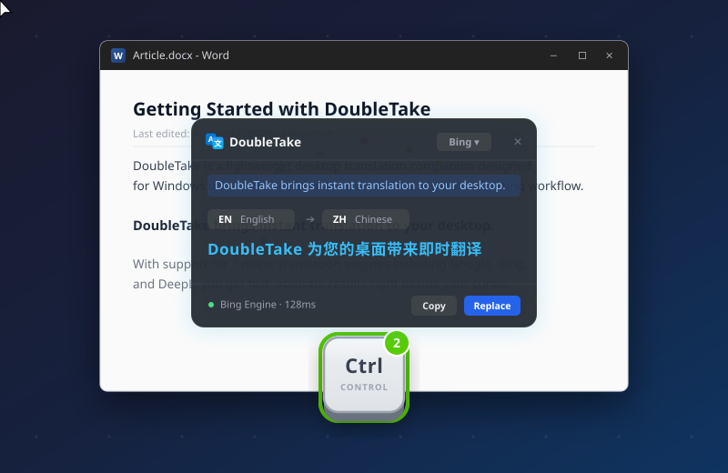

# Feedback

> *"Feedback—sending back information about what action has been done and what result has been accomplished—is a well-known concept in the science of control and information theory."* — Don Norman

---

## 1. Definition (my own words, ≤ 3 sentences)
Feedback is the immediate sensory return of information to the user confirming that an action was received, what effect it produced, and what state the system is currently in. It bridges the [[gulf-of-evaluation]] by converting invisible machine state changes into perceivable visual, auditory, or tactile signals. Without timely and proportionate feedback, users experience uncertainty, duplicate inputs, and self-blame.

---

## 2. Quantitative Cognitive Latency Limits (X-Y Model)

In human-computer interaction, "immediate" is strictly quantified by neurobiology and human attention spans (Robert Miller 1968, Card/Moran/Newell 1983, Jakob Nielsen).

```
Sense of Direct Causality & Attention
  ▲
  │
  │ 100% ──────┐ [0.1s: Direct Manipulation]
  │            │ • Feels instantaneous (visceral reaction)
  │            │ • Keypress click, dragging slider, physical switch
  │  70%       └─────────────┐ [1.0s: Unbroken Flow of Thought]
  │                          │ • Noticeable delay, but mental focus holds
  │                          │ • Page navigation, simple database query
  │  20%                     └───────────────────────────► [10.0s+: Attention Lost]
  │                                                        • User switches tasks or checks phone
  │                                                        • Progress bar or notification required
  0 ───────────┬─────────────┬─────────────┬─────────────►
             0.1 s         1.0 s        10.0 s            Response Time (Log Scale)
           (100 ms)
```

```
┌────────────────────────────────────────────────────────────────────────┐
│                        THE 3 RESPONSE-TIME LIMITS                      │
├────────────────────┬──────────────────┬────────────────────────────────┤
│ Threshold          │ Human Experience │ Interaction Requirement        │
├────────────────────┼──────────────────┼────────────────────────────────┤
│ **0.1 s (100 ms)** │ Instantaneous    │ Direct manipulation; no lag.   │
│ **1.0 s**          │ Thinking flow    │ Uninterrupted task context.    │
│ **10.0 s**         │ Attention lost   │ Percent bar or background job. │
└────────────────────┴──────────────────┴────────────────────────────────┘
```

---

## 3. Feedforward vs. Feedback

```
                    ┌───────────────────────────────┐
                    │     USER GOAL / INTENTION     │
                    └───────────────┬───────────────┘
                                    │
                  ┌─────────────────┴─────────────────┐
                  ▼                                   ▼
          [ FEEDFORWARD ]                       [ FEEDBACK ]
          (Before Action)                       (After Action)
          • "What *will* happen?"               • "What *just* happened?"
          • Hover button highlight              • Mechanical tactile click
          • Drag snap-to guidelines             • Loading spinner / progress
          • Ghost drop-target container         • Audio success chime
          • Cursor shape shift (grab/pointer)   • "Message Sent" toast banner
```

- **Feedforward:** Signals what to expect *before* committing the motor act, narrowing the [[gulf-of-execution]].
- **Feedback:** Communicates the outcome *after* the motor act, narrowing the [[gulf-of-evaluation]].

---

## 4. The 4 Cardinal Laws of Good Feedback

```
┌────────────────────────────────────────────────────────────────────────┐
│                   THE 4 CARDINAL LAWS OF GOOD FEEDBACK                 │
├────────────────────┬───────────────────────────────────────────────────┤
│ 1. IMMEDIATE       │ Acknowledge touch/click within <100ms, even if    │
│    (< 100 ms)      │ backend processing takes seconds.                 │
├────────────────────┼───────────────────────────────────────────────────┤
│ 2. INFORMATIVE     │ Explain *what occurred* in human terms. Never use │
│                    │ silent failures or cryptic hexadecimal codes.     │
├────────────────────┼───────────────────────────────────────────────────┤
│ 3. PROPORTIONATE   │ Minor actions = subtle sensory cues (soft click). │
│                    │ Destructive actions = salient confirmation.       │
├────────────────────┼───────────────────────────────────────────────────┤
│ 4. RESTRAINED      │ Suppress noise. Over-signaling trivial events     │
│                    │ causes habituation and dangerous Alarm Fatigue.   │
└────────────────────┴───────────────────────────────────────────────────┘
```

---

## 5. The Pathology of Feedback Overload: Alarm Fatigue

```
┌────────────────────────────────────────────────────────────────────────┐
│                     THE FEEDBACK DESIGN SPECTRUM                       │
├────────────────────┬─────────────────────────────┬─────────────────────┤
│   ZERO FEEDBACK    │      OPTIMAL FEEDBACK       │    ALARM FATIGUE    │
├────────────────────┼─────────────────────────────┼─────────────────────┤
│ User is blind;     │ Salient, proportional cues; │ System screams 24/7;│
│ repeated clicks,   │ timely, unobtrusive         │ humans habituate &  │
│ anxious guesswork. │ reassurance.                │ silence all alerts. │
└────────────────────┴─────────────────────────────┴─────────────────────┘
```

When systems produce too much non-critical feedback (e.g., constant chirps in hospital Intensive Care Units, incessant lane-departure chimes in modern cars), the human brain naturally tunes out the auditory channel. 
- In medicine, **Alarm Fatigue** is recognized by the FDA as a leading cause of patient death—nurses silence or ignore monitors after hundreds of false alarms.
- In nuclear engineering, the **Three Mile Island** disaster was exacerbated by over 100 simultaneous blinking alarm annunciators, completely blinding operators to the true root cause.

---

## 6. Why it matters for software engineers
Engineers frequently build forms and asynchronous workflows with broken feedback loops:
- **The Frozen Button Slip:** A user clicks "Submit Order", but the button remains visually static while waiting for a 2-second Stripe API response. The user assumes the click missed and clicks three more times, submitting duplicate transactions.
- **The Optimistic UI Remedy:** Instantly render the expected success state (<100ms) while the background network request resolves, reverting gracefully only if a server error occurs.
- Designing feedback means treating **state visibility** as a first-class architectural requirement, not a cosmetic after-thought.

### Case Study: Defending Working Memory with In-Situ Feedback (DoubleTake)

<div style="display: flex; gap: 24px; align-items: flex-start; margin: 20px 0;">
  <!-- Left: Analytical Narrative -->
  <div style="flex: 1.2;">
    <p style="font-size: 0.75em; text-transform: uppercase; letter-spacing: 1.5px; opacity: 0.6; margin-bottom: 4px;">
      REAL-WORLD SOFTWARE CASE · IN-SITU FEEDBACK
    </p>
    <h4 style="margin-top: 0;">Preserving Cognitive Flow via Cursor-Anchored Latency Reduction</h4>
    <p>Translation is among the highest-frequency micro-tasks in modern software development and research, yet standard desktop tools introduce catastrophic cognitive friction:</p>
    <ul>
      <li><strong>Viewport Dislocation & Context Switching:</strong> Copying text, switching to a browser tab (<code>Alt+Tab</code>), navigating to a web translator, and pasting requires <strong>8–15 seconds</strong>. This blows past the <strong>10-second attention-loss threshold</strong>, flushing the engineer's working memory stack and derailing task flow.</li>
      <li><strong>Commercial Noise vs. Calm Tech:</strong> Heavyweight commercial utilities (e.g., Youdao Translator) accumulate splash ads, document monetization popups, and broken hotkeys—violating Mark Weiser's principle of <em>Calm Technology</em>.</li>
      <li><strong>The In-Situ Solution (<a href="https://github.com/SaidimM/DoubleTake">DoubleTake</a>):</strong> By mapping a global <code>Double-Ctrl</code> tap, translation results pop up directly beside the text cursor in <strong>&lt; 500ms</strong>.</li>
      <li><strong>Motor Ergonomics:</strong> The <code>Ctrl</code> key acts as an anchor key at the keyboard corner. Tapping it twice requires zero finger contortion or hitbox searching, collapsing the action into a pure subconscious <strong>Behavioral motor schema</strong> that preserves train of thought.</li>
    </ul>
  </div>

  <!-- Right: Visual Evidence & Argumentative Caption -->
  <div style="flex: 0.8; max-width: 280px; flex-shrink: 0;">
    
    <p style="font-size: 0.82em; line-height: 1.4; opacity: 0.75; margin-top: 6px; border-left: 2px solid currentColor; padding-left: 8px;">
      <strong>DoubleTake In-Situ Architecture:</strong> Anchoring the translation dialogue directly to the text cursor eliminates viewport dislocation and keeps interaction latency within the &lt;1.0s flow-of-thought threshold.
    </p>
  </div>
</div>

---

## Related concepts
- [[gulf-of-evaluation]]
- [[gulf-of-execution]]
- [[seven-stages-of-action]]
- [[signifier]]
- [[Conceptual Model, System Image and Real usage]]