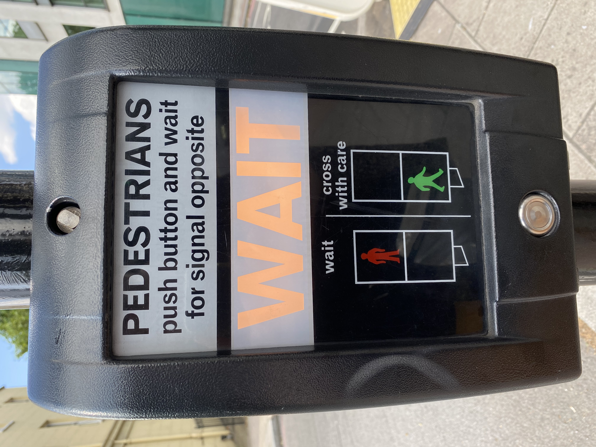

<p style="font-size: 0.8em; text-transform: uppercase; letter-spacing: 2px; opacity: 0.6; margin-bottom: 2px;">
HCI CORE CONCEPT · NORMAN ACTION CYCLE
</p>

# Gulf of Evaluation

*The distance between what the system did and your ability to tell whether it worked.*

> [!abstract] At a glance
> **What:** The gap between system state and the user's perception and interpretation of it.
> **Why:** It is where users get stuck asking 'did that work?'.
> **See it:** A form that submits with no visible confirmation.

> *"The Gulf of Evaluation reflects the amount of effort that the person must exert to interpret the physical state of the system and to determine how well the expectations and intentions have been met."* — Don Norman

---

## 1. Definition (my own words, ≤ 3 sentences)
The Gulf of Evaluation is the psychological gap between the physical state of a system and the user's perception, interpretation, and comparison of that state against their original goal. It answers the user's silent question: *"What state is the system in now, and did my action work?"* When a system provides immediate, understandable, and proportionate sensory [[feedback|feedback]], this gulf collapses.

---

## 2. Theoretical Architecture: The Evaluation Stages

```
┌────────────────────────────────────────────────────────────────────────┐
│                        THE SEVEN-STAGE ACTION CYCLE                    │
└───────────────────────────────────┬────────────────────────────────────┘
                                    │
                         ┌──────────▼──────────┐
                         │      1. GOAL        │
                         │ "Cross the Street"  │
                         └──────────▲──────────┘
                                    │
               ┌────────────────────┴────────────────────┐
               │                                         ▲
               │                              ╔══════════╧══════════╗
               │                              ║  GULF OF EVALUATION ║
               │                              ║   "Did it work?"    ║
               │                              ╚══════════╤══════════╝
               │                                         │
               │                                ┌────────┴────────┐
               │                                │ 7. COMPARE      │
               │                                │ Did signal change?
               │                                └────────▲────────┘
               │                                         │
               │                                ┌────────┴────────┐
               │                                │ 6. INTERPRET    │
               │                                │ "System registered"
               │                                └────────▲────────┘
               │                                         │
               │                                ┌────────┴────────┐
               │                                │ 5. PERCEIVE     │
               │                                │ See "WAIT" light│
               │                                └────────▲────────┘
               │                                         │
═══════════════╧═════════════════════════════════════════╧════════════════
                             PHYSICAL WORLD
                       (Interface / Machine State)
```

---

## 3. Real-World Physical & Digital Case Studies

### Physical Case: The Pedestrian Crossing "Wait" Button

<div style="display: flex; gap: 24px; align-items: flex-start; margin: 20px 0;">
  <!-- Left: Analytical Narrative -->
  <div style="flex: 1.2;">
    <p style="font-size: 0.75em; text-transform: uppercase; letter-spacing: 1.5px; opacity: 0.6; margin-bottom: 4px;">
      URBAN INTERACTION · SENSORY EVALUATION
    </p>
    <h4 style="margin-top: 0;">Uncertainty & Repeated Actuation in Urban Controls</h4>
    <p>A pedestrian reaches a busy intersection and presses the crosswalk actuation button.</p>
    <p>If the button lacks an immediate illuminated indicator (e.g. an illuminated <strong>"WAIT"</strong> sign or audible beep), the user cannot evaluate whether their physical actuation registered in the traffic controller. The resulting ambiguity widens the Gulf of Evaluation, prompting pedestrians to aggressively smash the button multiple times and blame the equipment.</p>
  </div>

  <!-- Right: Visual Evidence & Argumentative Caption -->
  <div style="flex: 0.8; max-width: 260px; flex-shrink: 0;">
    
    <p style="font-size: 0.82em; line-height: 1.4; opacity: 0.75; margin-top: 6px; border-left: 2px solid currentColor; padding-left: 8px;">
      <strong>Crosswalk Actuator with Illuminated Sign:</strong> An illuminated "WAIT" panel bridges the Gulf of Evaluation by verifying that the request has entered the traffic control loop.
    </p>
  </div>
</div>

---

### Digital / AI Frontier: The Evaluation Crisis in Non-Deterministic AI

In modern Generative AI and Autonomous Coding Agents, the Gulf of Evaluation is the single greatest interaction bottleneck:
- **The Execution is Easy:** A user types 5 words (*"build an authentication API"*), and the AI executes in 15 seconds.
- **The Evaluation is Hard:** The model outputs 400 lines of complex Python code. Evaluating whether the code contains subtle race conditions, deprecated dependencies, or hallucinated security flaws requires intense human cognitive labor.
- **The Modern HCI Challenge:** Tools must move away from walls of text toward **Automated Verifiability**—live sandbox previews, visual diff highlights, automated unit-test badges, and deterministic assertions that let users evaluate AI output in < 2 seconds.

---

## 4. How Designers Bridge the Gulf

```
┌────────────────────────────────────────────────────────────────────────┐
│                   BRIDGING THE GULF OF EVALUATION                      │
├────────────────────┬───────────────────────────────────────────────────┤
│ Design Mechanism   │ How It Collapses the Gap                          │
├────────────────────┼───────────────────────────────────────────────────┤
│ 1. SUB-100MS       │ Sensory feedback (click, haptic, glow) fires      │
│    CONFIRMATION    │ immediately upon touch, confirming receipt.       │
├────────────────────┼───────────────────────────────────────────────────┤
│ 2. TRANSPARENT     │ Clearly communicates internal machine progress    │
│    SYSTEM STATUS   │ (e.g. spinners, percent bars, ETA indicators).    │
├────────────────────┼───────────────────────────────────────────────────┤
│ 3. SENSORY MATCH   │ Maps sensory modality to context: quiet tactile   │
│                    │ for routine tasks; loud audio/visual for danger.  │
├────────────────────┼───────────────────────────────────────────────────┤
│ 4. HUMAN-CENTRIC   │ Translates internal states into plain language,   │
│    DIAGNOSTICS     │ never raw error codes (e.g. "Error 0x80070005").  │
└────────────────────┴───────────────────────────────────────────────────┘
```

---

## 5. False Blame & Learned Helplessness
When systems fail to bridge the Gulf of Evaluation, users instinctively blame themselves:
> *"Did I not press it hard enough? Am I doing something wrong?"*

Norman emphasizes that this is **systemic design failure**, not user incompetence. When an interface fails to communicate state, users develop **learned helplessness**—they become anxious and afraid to explore features.

---

## 6. Why it matters for software engineers
Engineers frequently neglect intermediate UI states:
- **The Optimistic Update Failure:** When an optimistic UI instantly checks a checkbox, but the background GraphQL mutation fails silently, the user's mental model drifts from database reality.
- **Skeleton Screens vs. Blank Spinners:** Skeleton screens reduce perceived evaluation time by showing structural layout progress, reassuring users that content is actively loading.

---

## Related concepts
- [[gulf-of-execution]]
- [[seven-stages-of-action]]
- [[feedback]]
- [[Conceptual Model, System Image and Real usage]]
- [[slips-vs-mistakes]]
