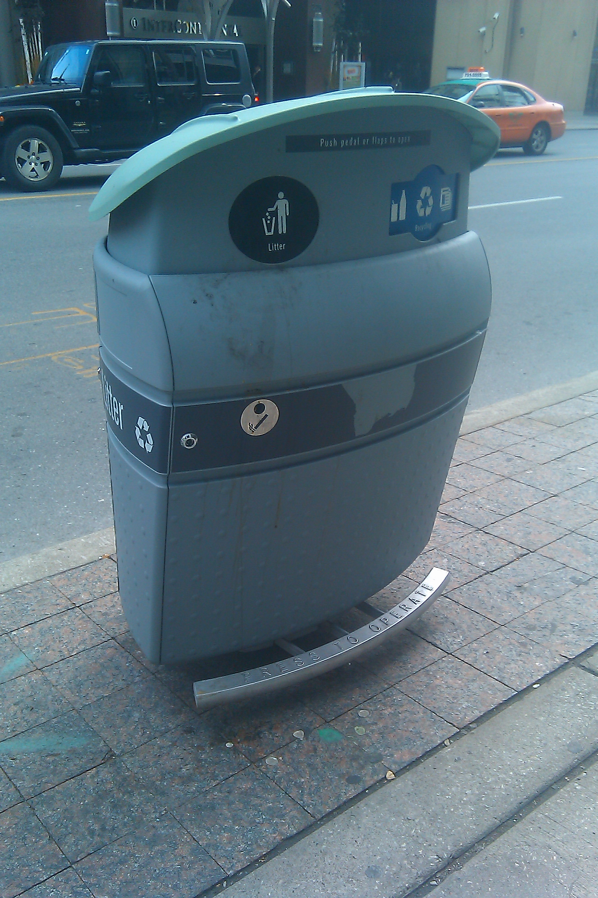
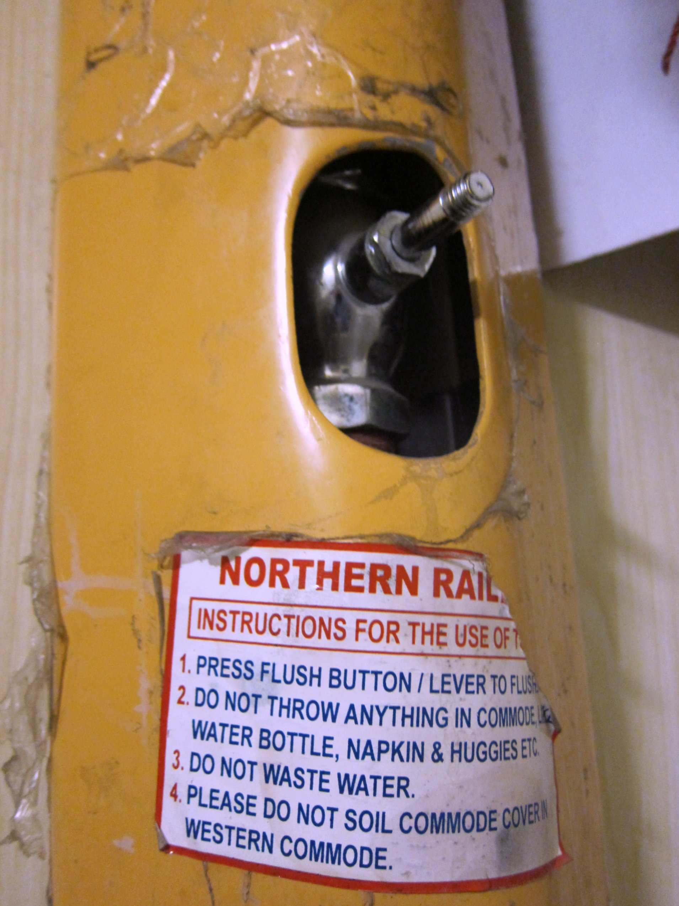
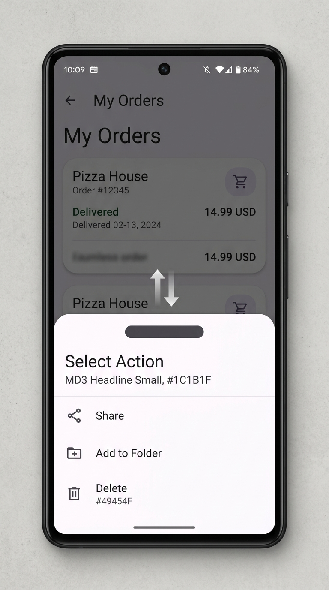
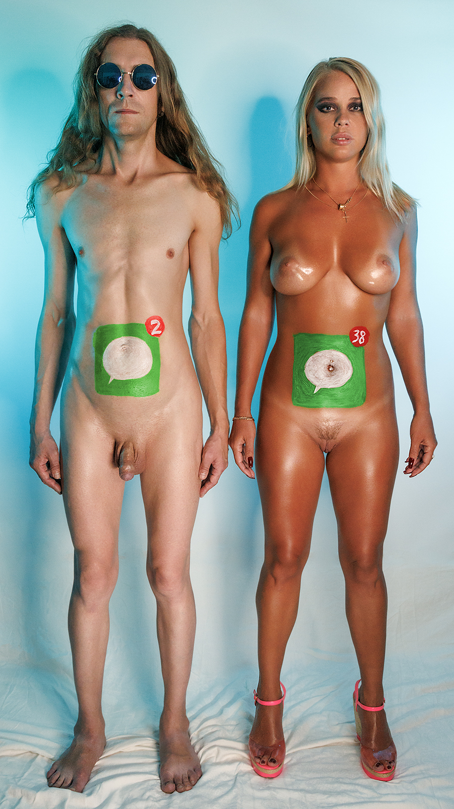
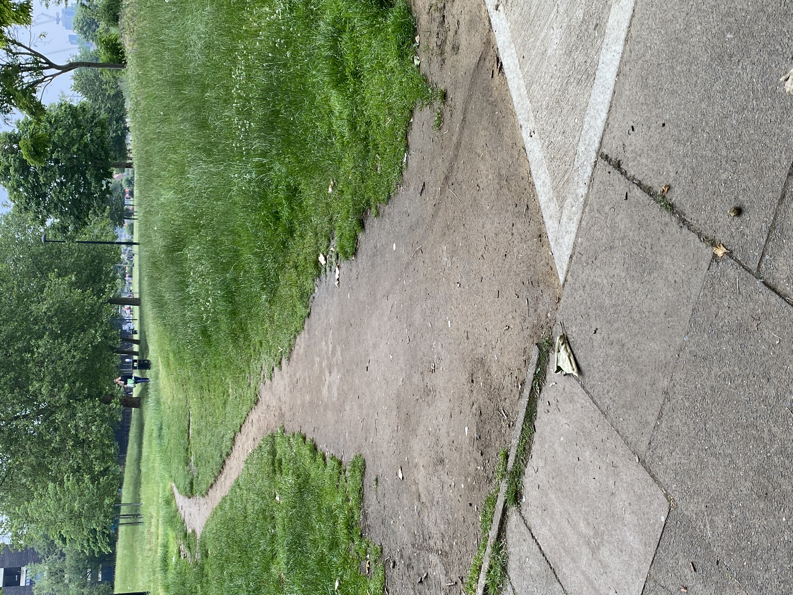
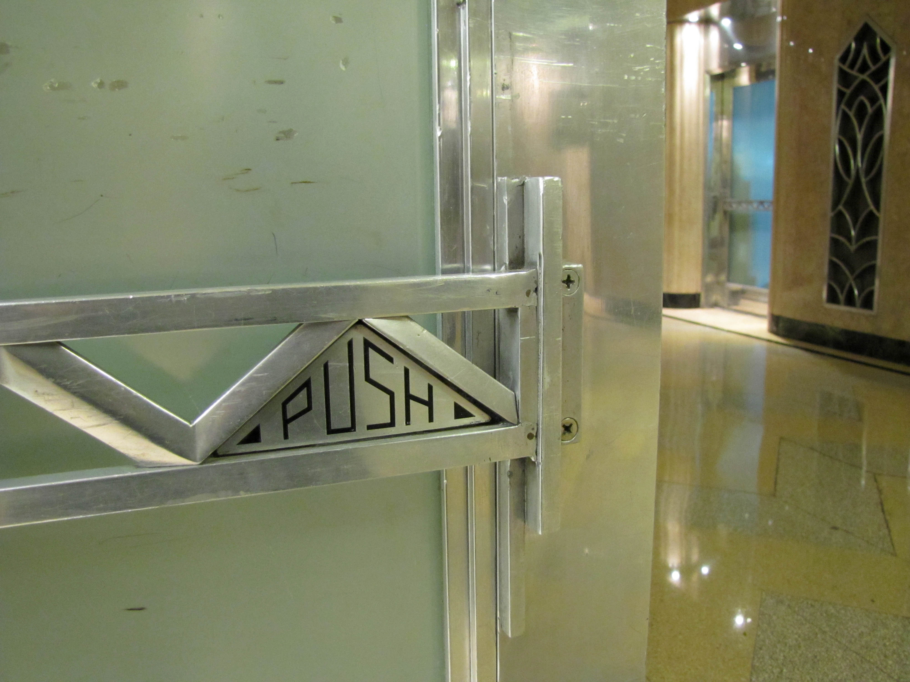
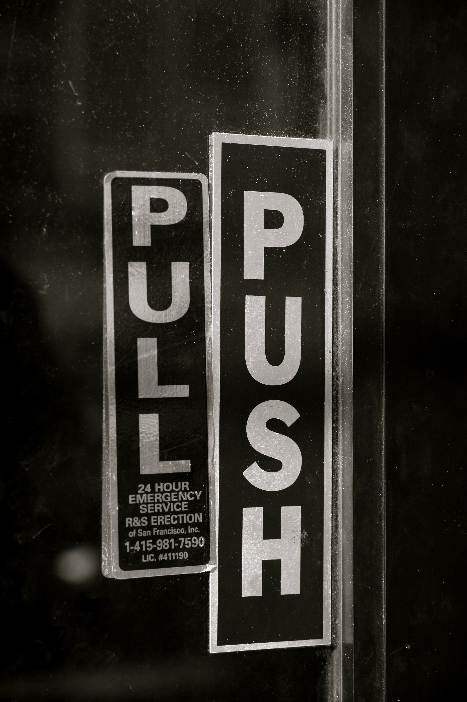

# Signifier

*The perceivable cue that tells you where to act, how to act, and what state the system is in.*

> [!abstract] At a glance
> **What:** Any perceivable signal that communicates an affordance or system state.
> **Why:** People can't use what they can't discover; screens have almost no physical affordances to lean on.
> **See it:** A frosted decal on a glass door.

> *"Affordances define what actions are possible. Signifiers specify where the action should take place."* — Don Norman

---

## 1. Definition (my own words, ≤ 3 sentences)
A signifier is any perceivable signal, mark, or physical trace that communicates the presence of an [[affordance]] or the state of a system to an agent. While an affordance determines what actions are physically possible, a signifier specifies **what** action can be taken, **where** that action should take place, **how** it should be performed, and **what state** the system is currently in. Signifiers can be deliberately designed or naturally emergent from use.

---

## 2. Core Architecture: How Signifiers Bridge the Action Gap

```
┌──────────────────────────────────────────────────────────────┐
│                    THE HUMAN - MACHINE GAP                   │
└──────────────────────────────┬───────────────────────────────┘
                               │
                               ▼
                   ┌───────────────────────┐
                   │   PHYSICAL OBJECT     │
                   │   (Actual Affordance) │
                   └───────────┬───────────┘
                               │
          Is the affordance directly perceivable by human senses?
                         /           \
                   [ YES ]           [ NO ]
                      │                 │
                      │        ┌────────┴────────┐
                      │        │ SIGNIFIER REQ'D │
                      │        │ (Signal / Mark) │
                      │        └────────┬────────┘
                      │                 │
                      ▼                 ▼
         ┌─────────────────────────────────────────┐
         │       PERCEIVED ACTIONABLE WORLD        │
         │       (User Mental Model Formed)        │
         └────────────────────┬────────────────────┘
                              │
          ┌───────────────────┴───────────────────┐
          ▼                                       ▼
  [ Gulf of Execution ]                   [ Gulf of Evaluation ]
  • "Where do I push/tap?"                • "Did my press register?"
  • "Which direction to pull?"            • "What state is it in now?"
```

---

## 3. The Four Questions Answered by a Signifier

```
┌────────────────────────────────────────────────────────────────────────┐
│                       THE 4 SIGNIFIER DIMENSIONS                       │
├──────────────────┬──────────────────┬──────────────────┬───────────────┤
│     1. WHAT      │    2. WHERE      │     3. HOW       │   4. STATE    │
│  (Action Type)   │ (Spatial Target) │ (Motor Gesture)  │(System Health)│
├──────────────────┼──────────────────┼──────────────────┼───────────────┤
│  [ Trash Pedal ] │ [ Toilet Button] │ [  BottomSheet ] │ [ App Badge ] │
│     ┌──────┐     │     ┌──────┐     │     ┌──────┐     │    ┌──────┐   │
│     │ STEP │     │     │ PUSH │     │     │ DRAG │     │    │  (3) │   │
│     └──────┘     │     └──────┘     │     └──▲───┘     │    └──────┘   │
│        ▼         │        ▼         │        │         │        ▼      │
│ "Lid will open"  │ "Flush volume"   │ "Slide upward"   │ "3 new alerts"│
└──────────────────┴──────────────────┴──────────────────┴───────────────┘
```

### Real-World Photo Examples

<div style="display: flex; gap: 24px; align-items: center; margin: 16px 0;">
  <div style="flex: 1;">
    <h4>01 · WHAT is possible? (Action Possibility)</h4>
    <p><strong>Trash Can Foot Pedal:</strong> The ribbed lever at floor level signifies that foot depression triggers lid opening, preserving sanitary hands without requiring printed instructions.</p>
  </div>
  <div style="width: 220px; flex-shrink: 0;">
    
    <p style="font-size: 0.8em; opacity: 0.7; margin-top: 4px; text-align: center;"><em>Pedal at floor level signals foot actuation.</em></p>
  </div>
</div>

<div style="display: flex; gap: 24px; align-items: center; margin: 16px 0;">
  <div style="flex: 1;">
    <h4>02 · WHERE to act? (Spatial Touch Target)</h4>
    <p><strong>Toilet Dual-Flush Button:</strong> Recessed chrome crescents demarcate the exact physical touch target and mechanical water volume choice (half vs. full flush).</p>
  </div>
  <div style="width: 220px; flex-shrink: 0;">
    
    <p style="font-size: 0.8em; opacity: 0.7; margin-top: 4px; text-align: center;"><em>Split chrome crescents indicate touch target & flush volume.</em></p>
  </div>
</div>

<div style="display: flex; gap: 24px; align-items: center; margin: 16px 0;">
  <div style="flex: 1;">
    <h4>03 · HOW to do it? (Kinematic / Direction)</h4>
    <p><strong>BottomSheet Grabber:</strong> A centered horizontal oval pill bar signals vertical-axis dragging, reinforced by introductory animated slide peek (Feedforward).</p>
  </div>
  <div style="width: 220px; flex-shrink: 0;">
    
    <p style="font-size: 0.8em; opacity: 0.7; margin-top: 4px; text-align: center;"><em>Pill grabber signals vertical drag affordance.</em></p>
  </div>
</div>

<div style="display: flex; gap: 24px; align-items: center; margin: 16px 0;">
  <div style="flex: 1;">
    <h4>04 · System STATE? (Status & Readiness)</h4>
    <p><strong>App Badges & Kettle LEDs:</strong> Red counter pills or green glowing rings communicate the invisible background status of the system (e.g., 3 unread messages waiting).</p>
  </div>
  <div style="width: 220px; flex-shrink: 0;">
    
    <p style="font-size: 0.8em; opacity: 0.7; margin-top: 4px; text-align: center;"><em>Red dot badge signals unread state.</em></p>
  </div>
</div>

---

## 4. Deliberate vs. Accidental Signifiers

Signifiers do not only originate on a designer's canvas. They are split into two fundamental classes:

```
                  ┌───────────────────────────────┐
                  │       SIGNIFIER ORIGIN        │
                  └───────────────┬───────────────┘
                                  │
                 ┌────────────────┴────────────────┐
                 ▼                                 ▼
      [ DELIBERATE (Designed) ]         [ ACCIDENTAL (Physical Traces) ]
      • Painted road lines              • Desire paths across grass
      • Labeled CTA buttons             • Smudges on frequently pushed glass
      • Touchscreen grabber bars        • Worn wood on tavern door latch
      • Haptic buzz patterns            • Steam rising from kettle spout
```

### Accidental Signifier in the Wild: The Desire Path

<div style="display: flex; gap: 24px; align-items: flex-start; margin: 16px 0;">
  <div style="flex: 1;">
    <p>Natural physical traces left by previous users convey actionable meaning without deliberate design. A worn dirt trail across a lawn signifies the optimal human route.</p>
    <p>Shrewd architects observe these accidental signifiers before paving sidewalks, letting genuine human behavior guide the final design.</p>
  </div>
  <div style="width: 250px; flex-shrink: 0;">
    
    <p style="font-size: 0.8em; opacity: 0.7; margin-top: 4px; text-align: center;"><em>Desire path: footprints leave physical traces signaling optimal path.</em></p>
  </div>
</div>

---

## 5. Strong vs. Weak Signifiers (Norman's Rule)

> *"A door that needs a sign that says 'PUSH' or 'PULL' is a confession of design failure."* — Don Norman

```
┌─────────────────────────────────┬─────────────────────────────────┐
│        STRONG SIGNIFIERS        │         WEAK SIGNIFIERS         │
│     (Visceral & Behavioral)     │          (Reflective)           │
├─────────────────────────────────┼─────────────────────────────────┤
│ • Flat brass push plate         │ • Printed sticker: "PUSH"       │
│ • Contoured ergonomic grip      │ • Manual: "Turn left 90°"       │
│ • Physical slot sized to coin   │ • Warning text / tooltip banner │
│                                 │                                 │
│ Operates via geometry & muscle  │ Requires conscious reading;     │
│ memory; zero reading needed.    │ fails when rushed or dark.      │
└─────────────────────────────────┴─────────────────────────────────┘
```

### Strong Signifier: The Push Plate

<div style="display: flex; gap: 24px; align-items: flex-start; margin: 16px 0;">
  <div style="flex: 1;">
    <p>A flat brass plate can only be pushed—it physically cannot be grasped or pulled. The physical geometry itself serves as an unambiguous strong signifier that eliminates the Gulf of Execution without words.</p>
  </div>
  <div style="width: 240px; flex-shrink: 0;">
    
    <p style="font-size: 0.8em; opacity: 0.7; margin-top: 4px; text-align: center;"><em>Flat plate: geometry physically permits only pushing.</em></p>
  </div>
</div>

### Weak Signifier: The Confusing "Push & Pull" Norman Door

<div style="display: flex; gap: 24px; align-items: flex-start; margin: 16px 0;">
  <div style="flex: 1;">
    <p>When door hardware gives ambiguous signals, owners resort to printed signs. In extreme design failures, doors end up with contradictory "PUSH" and "PULL" labels pasted on the exact same door handle, leaving users bewildered.</p>
  </div>
  <div style="width: 240px; flex-shrink: 0;">
    
    <p style="font-size: 0.8em; opacity: 0.7; margin-top: 4px; text-align: center;"><em>The classic Norman door breakdown: contradictory text labels.</em></p>
  </div>
</div>

---

## 6. The Screen Reality: Why Norman Apologized

In the 1988 edition of *The Design of Everyday Things*, Norman used "affordance" loosely, leading software engineers to declare: *"I designed an affordance for this button."*

In the 2013 revised edition, Norman explicitly corrected this:
- On a glass touch display, the **physical affordances are fixed**—the glass affords tapping, sliding, and pinching anywhere across its surface.
- A button drawn on a screen **has no physical affordance**; it is entirely a **signifier** signaling an underlying virtual capability.
- **The Flat Design Trap:** When designers stripped away drop shadows, borders, and bevels (e.g., early iOS 7), they removed critical signifiers, drastically widening the [[gulf-of-execution]] because users could no longer distinguish interactive elements from static labels.

---

## 7. Why it matters for software engineers
Engineers frequently build powerful APIs and UI controls without intuitive signifiers, expecting users to "just know" or read documentation. If users struggle to locate where to click, guess whether an item is draggable, or miss destructive actions, the fault lies in missing or deceptive signifiers. Clear signifiers make virtual affordances discoverable.

---

## Related concepts
- [[affordance]]
- [[gulf-of-execution]]
- [[gulf-of-evaluation]]
- [[feedback]]
- [[seven-stages-of-action]]
