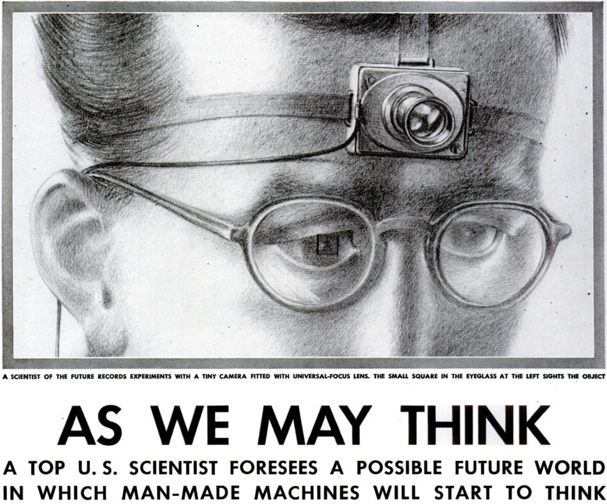
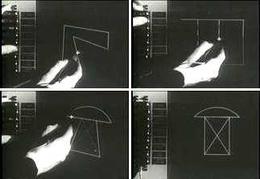
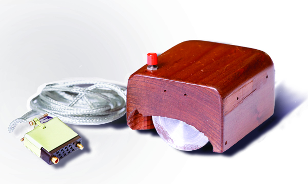
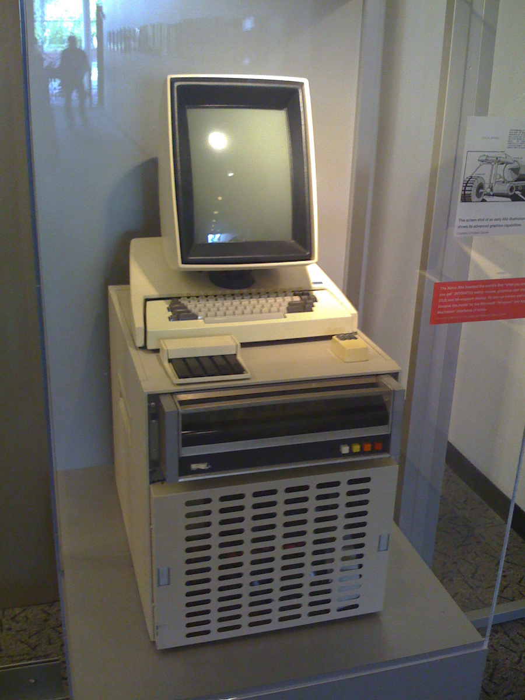

# Lecture Notes — CS147 Lecture 2: Early Visions

> Lecture slides: [02-early-visions.pdf](https://hci.stanford.edu/courses/cs147/)  
> Key historical lineage: Vannevar Bush → J.C.R. Licklider → Ivan Sutherland → Douglas Engelbart → Alan Kay / Xerox PARC → Mark Weiser

---

## 1. The Red Thread: Augmenting Human Intellect (Not Automation)

Before these visionaries, computers were conceived purely as **calculating engines** (automating arithmetic for military ballistics and payroll). The pioneers below re-imagined computing as **cognitive prosthetics** for the human mind.

```text
┌────────────────────────────────────────────────────────────────────────┐
│                   THE EVOLUTION OF INTERACTIVE COMPUTING               │
├──────┬──────────────────────┬──────────────────────────────────────────┤
│ Year │ Pioneer / System     │ Conceptual Breakthrough                  │
├──────┼──────────────────────┼──────────────────────────────────────────┤
│ 1945 │ Vannevar Bush        │ Associative memory & trails (The Memex)  │
│ 1963 │ Ivan Sutherland      │ Direct manipulation & constraints (OOP)  │
│ 1968 │ Douglas Engelbart    │ Augmentation, NLS, "Mother of All Demos" │
│ 1973 │ Xerox PARC           │ Desktop metaphor, bitmapped GUI, WYSIWYG │
│ 1991 │ Mark Weiser          │ Ubiquitous & Calm Computing              │
└──────┴──────────────────────┴──────────────────────────────────────────┘
```

---

## 2. Vannevar Bush & the Memex (1945)

<div style="display: flex; gap: 24px; align-items: flex-start; margin: 20px 0;">
  <!-- Left Column: The Narrative Argument (~60%) -->
  <div style="flex: 1.2;">
    <p style="font-size: 0.75em; text-transform: uppercase; letter-spacing: 1.5px; opacity: 0.6; margin-bottom: 4px;">
      HISTORICAL MILESTONE · ASSOCIATIVE COGNITION
    </p>
    <h4 style="margin-top: 0;">Escaping the Hierarchical Indexing Trap</h4>
    <p>In his seminal essay <em>"As We May Think"</em> (The Atlantic, 1945), Vannevar Bush identified a critical cognitive bottleneck: human knowledge was exploding post-WWII, yet storage systems remained shackled to rigid alphabetical and numerical indices.</p>
    <ul>
      <li><strong>Cognitive Mismatch:</strong> The human mind does not file thoughts hierarchically; it operates by <strong>association</strong>. One idea instantly snaps to another along associative pathways.</li>
      <li><strong>The Machine:</strong> Bush conceptualized the <strong>Memex</strong> ("Memory Extender")—a mechanized desk with dual translucent projection screens, microfilm archives, and a scanner platen.</li>
      <li><strong>Associative Trails:</strong> A researcher could tie arbitrary documents together with persistent links, building personalized research trails that could be shared and traversed instantly.</li>
      <li><strong>Legacy:</strong> Direct intellectual ancestor of <strong>Ted Nelson's Hypertext</strong>, Tim Berners-Lee's <strong>World Wide Web</strong>, and personal knowledge graphs like Obsidian.</li>
    </ul>
  </div>

  <!-- Right Column: Visual Artifact & Argumentative Caption (~40%) -->
  <div style="flex: 0.8; max-width: 280px; flex-shrink: 0;">
    
    <p style="font-size: 0.82em; line-height: 1.4; opacity: 0.75; margin-top: 6px; border-left: 2px solid currentColor; padding-left: 8px;">
      <strong>The Memex Desk (Life Magazine, 1945):</strong> Bush rejected rigid alphabetical taxonomy, modeling an associative indexing workstation that mirrored the human brain's natural cognitive leaps—the conceptual birth of bi-directional hyperlinking.
    </p>
  </div>
</div>

---

## 3. Ivan Sutherland & Sketchpad (1963)

<div style="display: flex; gap: 24px; align-items: flex-start; margin: 20px 0;">
  <!-- Left Column: The Narrative Argument (~60%) -->
  <div style="flex: 1.2;">
    <p style="font-size: 0.75em; text-transform: uppercase; letter-spacing: 1.5px; opacity: 0.6; margin-bottom: 4px;">
      GRAPHICAL REVOLUTION · DIRECT MANIPULATION
    </p>
    <h4 style="margin-top: 0;">The Screen as a Virtual Constraint World</h4>
    <p>Before Ivan Sutherland's PhD thesis at MIT Lincoln Laboratory, computers took batch punch cards and spewed paper printouts. Sutherland transformed the CRT display into an interactive canvas using a <strong>light pen</strong>.</p>
    <ul>
      <li><strong>First Direct Manipulation:</strong> Instead of typing numerical coordinates into batch queues, users pointed and drew vector geometries directly onto the phosphor screen with immediate visual feedback.</li>
      <li><strong>Geometric Constraint Solvers:</strong> Users could specify topological rules (e.g., <em>"make these lines parallel"</em> or <em>"lock this vertex to circle circumference"</em>), which the computer maintained dynamically during transformations.</li>
      <li><strong>Birth of Object-Oriented Programming (OOP):</strong> Sutherland invented <strong>"Master Drawings" and "Instances"</strong>. Modifying properties on a Master drawing instantly cascaded updates to all referenced instances—predating Smalltalk and C++ classes by decades.</li>
    </ul>
  </div>

  <!-- Right Column: Visual Artifact & Argumentative Caption (~40%) -->
  <div style="flex: 0.8; max-width: 280px; flex-shrink: 0;">
    
    <p style="font-size: 0.82em; line-height: 1.4; opacity: 0.75; margin-top: 6px; border-left: 2px solid currentColor; padding-left: 8px;">
      <strong>Ivan Sutherland Operating Sketchpad (1963):</strong> By drawing with a light pen and enforcing geometric constraints, Sutherland replaced batch alphanumeric punch cards with direct manipulation, establishing master-instance relationships before OOP existed.
    </p>
  </div>
</div>

---

## 4. Douglas Engelbart & "The Mother of All Demos" (1968)

<div style="display: flex; gap: 24px; align-items: flex-start; margin: 20px 0;">
  <!-- Left Column: The Narrative Argument (~60%) -->
  <div style="flex: 1.2;">
    <p style="font-size: 0.75em; text-transform: uppercase; letter-spacing: 1.5px; opacity: 0.6; margin-bottom: 4px;">
      HUMAN AUGMENTATION · NLS SYSTEM
    </p>
    <h4 style="margin-top: 0;">Amplifying Intellect: The Mother of All Demos</h4>
    <p>On December 9, 1968, Douglas Engelbart and his team at SRI presented the <strong>NLS (oN-Line System)</strong> to 1,000 computer scientists in San Francisco via a custom 30-mile microwave link:</p>
    <ul>
      <li><strong>The Inventions:</strong> Demonstrated the <strong>mouse</strong>, 2D on-screen windowed text editing, hypertext jumping, line-by-line revision control (early Git), distributed collaborative editing, and split-screen video conferencing.</li>
      <li><strong>Client-Server Architecture:</strong> An interactive terminal connected to a central time-shared mainframe—laying the architectural foundation for modern SaaS and cloud collaboration.</li>
    </ul>
  </div>

  <!-- Right Column: Visual Artifact & Argumentative Caption (~40%) -->
  <div style="flex: 0.8; max-width: 280px; flex-shrink: 0;">
    
    <p style="font-size: 0.82em; line-height: 1.4; opacity: 0.75; margin-top: 6px; border-left: 2px solid currentColor; padding-left: 8px;">
      <strong>The First Computer Mouse Prototype (SRI, 1964):</strong> Carved from wood with orthogonal metal wheels, Engelbart and Bill English engineered a continuous 2D pointing transducer that minimized cognitive translation, drastically narrowing Norman's Gulf of Execution.
    </p>
  </div>
</div>

### The "Tricycle vs. Bicycle" Principle

> *"If ease of use was the only valid criterion, people would stick to tricycles and never try bicycles."*  
> — **Douglas Engelbart**

```text
┌────────────────────────────────────────────────────────────────────────┐
│                   THE TRICYCLE VS. BICYCLE TRADEOFF                    │
├────────────────────┬──────────────────┬────────────────────────────────┤
│ Tool Paradigm      │ Learning Curve   │ Mastery / Ceiling              │
├────────────────────┼──────────────────┼────────────────────────────────┤
│ **The Tricycle**   │ Zero training    │ Capped at 3 mph                │
│ (Consumer / Walk-up)│ Walk-up-and-use  │ Low expressive efficiency      │
├────────────────────┼──────────────────┼────────────────────────────────┤
│ **The Bicycle**    │ Requires balance │ Superhuman velocity (25+ mph)  │
│ (Expert Workstation)│ Falls & practice │ Multiplies human capacity      │
└────────────────────┴──────────────────┴────────────────────────────────┘
```

- **HCI Implication:** "Ease of use" cannot be evaluated in isolation from the **task domain and user frequency**. Consumer applications demand immediate walk-up usability, but professional systems (IDEs, flight control, surgery, CAD) prioritize high ceiling and expressive bandwidth over zero initial learning curve.

---

## 5. Xerox PARC & The Desktop Metaphor (1970s–1984)

<div style="display: flex; gap: 24px; align-items: flex-start; margin: 20px 0;">
  <!-- Left Column: The Narrative Argument (~60%) -->
  <div style="flex: 1.2;">
    <p style="font-size: 0.75em; text-transform: uppercase; letter-spacing: 1.5px; opacity: 0.6; margin-bottom: 4px;">
      DEMOCRATIZATION · GRAPHICAL INTERFACES
    </p>
    <h4 style="margin-top: 0;">Grounding Abstraction in Familiar Physics</h4>
    <p>While Engelbart's NLS was immensely powerful, its steep learning curve (chorded keyset and command grammar) locked out non-experts. Alan Kay, Adele Goldberg, and the Xerox PARC team bridged this gulf with the <strong>Alto (1973)</strong> and <strong>Star (1981)</strong>.</p>
    <ul>
      <li><strong>The Desktop Metaphor:</strong> Abstract file system inodes and directories were mapped to everyday office conceptual models: desktop surfaces, folders, documents, and a trash can.</li>
      <li><strong>WYSIWYG & Bitmapped Displays:</strong> What You See Is What You Get typography and graphics rendered identically on screen and laser printer.</li>
      <li><strong>The Steve Jobs Inception (1979):</strong> Jobs visited Xerox PARC, recognized that the GUI would transform personal computing, and licensed the concepts to develop the Lisa and the <strong>Apple Macintosh (1984)</strong>.</li>
    </ul>
  </div>

  <!-- Right Column: Visual Artifact & Argumentative Caption (~40%) -->
  <div style="flex: 0.8; max-width: 280px; flex-shrink: 0;">
    
    <p style="font-size: 0.82em; line-height: 1.4; opacity: 0.75; margin-top: 6px; border-left: 2px solid currentColor; padding-left: 8px;">
      <strong>Xerox Alto Workstation (PARC, 1973):</strong> Alan Kay and the PARC team translated Engelbart's expert workstation into the intuitive Desktop Metaphor (overlapping windows, icons, bitmapped typography), providing the blueprint Steve Jobs adapted for the 1984 Macintosh.
    </p>
  </div>
</div>

---

## 6. Mark Weiser: Ubiquitous & Calm Computing (1991)

> *"The most profound technologies are those that disappear. They weave themselves into the fabric of everyday life until they are indistinguishable from it."*  
> — **Mark Weiser**, *The Computer for the 21st Century* (1991)

- **Calm Technology:** Good design does not monopolize conscious attention. It rests quietly in the periphery of our awareness, smoothly shifting to the center only when task execution demands it.
- **The Physical Computing Hierarchy:** Weiser envisioned computation distributed across three spatial scales:
  1. **Tabs:** Inch-scale devices (smartwatches, tags, contextual sensors).
  2. **Pads:** Foot-scale portable devices (tablets, e-readers).
  3. **Boards:** Yard-scale shared surfaces (interactive whiteboards, smart displays).

---

## 7. Cinematic UIs vs. Ergonomic Reality: *Minority Report* & "Gorilla Arm"

```text
┌────────────────────────────────────────────────────────────────────────┐
│                     THE ERGONOMIC REALITY SPECTRUM                     │
├────────────────────┬───────────────────────────────────────────────────┤
│ Hollywood Sci-Fi   │ Flamboyant mid-air gestures; looks heroic on film │
│ (Minority Report)  │ but inflicts biomechanical failure in minutes.    │
├────────────────────┼───────────────────────────────────────────────────┤
│ Ergonomic Reality  │ Resting hands, supported forearms, micro-motions; │
│ (HCI Science)      │ zero unnecessary isometric shoulder strain.       │
└────────────────────┴───────────────────────────────────────────────────┘
```

- **Gorilla Arm Syndrome:** Holding arms outstretched in unsupported free air causes rapid isometric strain of the anterior deltoids and trapezius, with acute lactic acid exhaustion within 2–5 minutes.
- **The Spatial Computing Frontier:** What is the ergonomic 3D successor to the mouse?
  - Unsupported mid-air gestures fail prolonged knowledge work.
  - Viable paradigms leverage **gaze-directed intent + passive resting micro-gestures** (e.g., Apple Vision Pro pinch while hands rest on lap) or desktop spatial styluses.

---

## 💡 Concept Connections & Terms

- [[direct-manipulation]] — Continuous representation of objects with rapid, reversible incremental actions.
- [[gulf-of-execution]] — The distance between user intent and physical input mechanisms.
- [[gulf-of-evaluation]] — The distance between system output and user mental models.
- [[ubiquitous-computing]] — Calm, ambient computation woven into the physical world.
- [[fitts-law]] — Mathematical formulation of pointing speed as a function of distance and target size.

---

## ❓ Open Questions (→ [[questions]])

- *How do modern Agentic / Generative AI interfaces balance Engelbart's Augmentation (giving users high-ceiling bicycles) vs. naive automation (turning users into passive spectators)?*
- *What is the ergonomic input transducer for 3D spatial computing that matches the sustained efficiency of the 2D mouse?*
